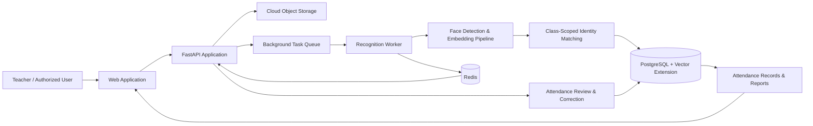
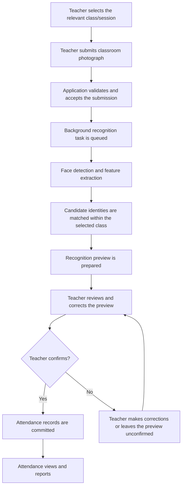

# FACIFY — Architecture Overview

> **Documentation-only repository.** This repository presents a high-level overview of FACIFY's system design and workflows. It does not contain application source code, model weights, biometric data, credentials, deployment secrets, or institution-specific records.

**FACIFY** is an institutional classroom attendance platform that uses facial recognition to assist attendance preparation, with a human review step before attendance is confirmed.

## Project at a glance

- **Project type:** Institutional software project
- **Role:** Lead Developer
- **Deployment:** AWS deployment used for institutional pilot testing
- **Pilot reach:** Tested across two institutions, covering 627+ students
- **Core technologies:** FastAPI, PostgreSQL, pgvector, Redis, Celery, InsightFace, ONNX Runtime, OpenCV, AWS

## High-level architecture

The following diagram is intentionally conceptual. It communicates the major component responsibilities and data flow without publishing internal implementation details.

## Attendance workflow

## Component responsibilities

| Component | Responsibility |
|---|---|
| Web application | Teacher-facing workflows for submitting photos and reviewing attendance |
| FastAPI application | Application API and workflow coordination |
| Background worker | Executes recognition tasks outside the request-response path |
| InsightFace / ONNX Runtime / OpenCV | Face detection, feature extraction and image-processing pipeline |
| PostgreSQL / pgvector | Application persistence and vector-backed representation storage |
| Redis / Celery | Background task coordination and transient processing state |
| Cloud object storage | Stores application-managed image objects |
| Review workflow | Keeps a teacher in the loop before attendance is confirmed |

This table is an architectural summary, not a complete deployment specification.

## Design considerations

- **Human-in-the-loop:** Recognition output is presented for teacher review; it is not treated as an unquestionable final decision.
- **Asynchronous processing:** Image analysis is handled as background work so the user-facing application does not need to perform the full pipeline synchronously.
- **Class-scoped matching:** Candidate matching is constrained to the relevant class context.
- **Separation of responsibilities:** API coordination, recognition processing, persistence and review are represented as distinct responsibilities.
- **Privacy-aware publication:** No student photographs, face embeddings, personal records, credentials or live infrastructure details are included in this repository.

## Technology stack

**Application and API:** FastAPI  
**Recognition and image processing:** InsightFace, ONNX Runtime, OpenCV  
**Data layer:** PostgreSQL, pgvector  
**Background processing:** Celery, Redis  
**Cloud:** AWS

Only technologies that are part of the described project are listed here. This repository deliberately omits configuration values, exact endpoints, thresholds, schema definitions, network topology and security implementation details.

## Patent information

**Published Indian Patent Application:** 202521132881  
**Title:** *Context-Aware Multimodal Biometric Attendance System with Adaptive Sensing and Blockchain-Backed Verification*  
**Filing date:** 29 December 2025  
**Publication date:** 5 June 2026  
**Status shown in the supplied IP India application-status screenshot:** *Awaiting Request for Examination*

[Open the IP India Patent Application Status portal](https://ipresearch.ipindia.gov.in/PatentSearch/PatentSearch/ViewApplicationStatus)

> The portal is a general application-status search page. Enter application number **202521132881** manually to retrieve the record. The status above reflects the screenshot supplied for this documentation and may change; consult the official portal for the latest status.

This is a published application, **not a statement that a patent has been granted**. The official patent record lists multiple applicants. Refer to the official record for the complete applicant details and legal status.

## Repository scope and publication boundary

This repository is intended to demonstrate system-level engineering and project workflow. It intentionally excludes:

- Source code, model weights, training data and private repositories
- Student photographs, face crops, embeddings, names, IDs, attendance records or other personal data
- Credentials, API keys, tokens, environment files, certificates or private URLs
- Internal API routes, database schemas, SQL queries, matching thresholds or detailed security controls
- Institution-owned screenshots, logos, documents or diagrams unless publication permission has been obtained

Before making this repository public, obtain any required written approval from the institution and relevant project/patent stakeholders. A published patent application does not automatically authorize publication of institution-owned software, screenshots, internal documentation or confidential implementation details.

## Screenshots

The `screenshots/` directory is intentionally empty. Add only sanitized screenshots that you are authorized to publish. Remove names, faces, IDs, class details, timestamps tied to real students, browser tabs, URLs, notifications and other identifying information before adding any image.

## Disclaimer

This repository is an independently prepared, high-level technical overview for portfolio and educational purposes. It is not the application itself, does not provide a deployment guide, and should not be interpreted as a disclosure of the complete implementation. Institutional ownership, permissions and patent rights are governed by the applicable agreements and official records.

---

**Maintainer:** Affaan Shaikh  
**GitHub:** [@affaanshk](https://github.com/affaanshk)
