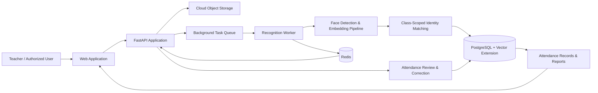

# High-level architecture (Mermaid)

This diagram is intentionally high-level. Do not add internal routes, network boundaries, credentials, exact data schemas, recognition thresholds, security controls or private infrastructure details to the public version.
